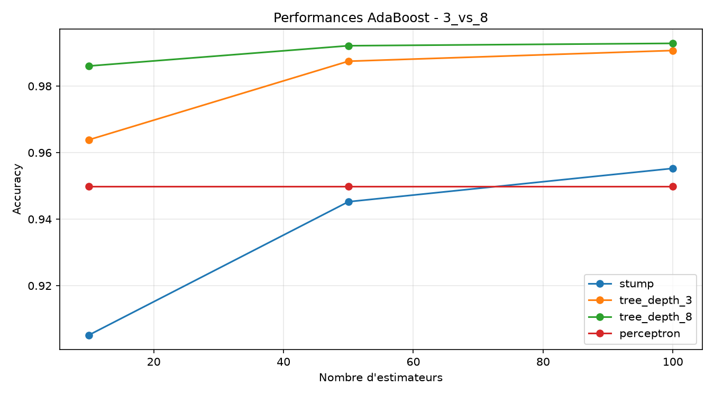
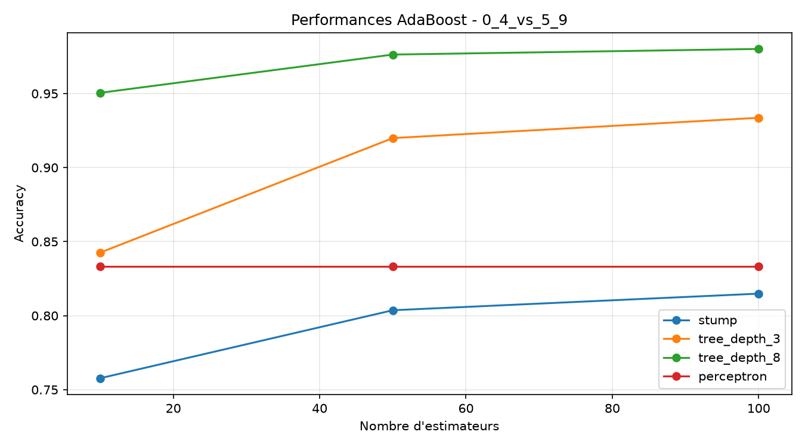
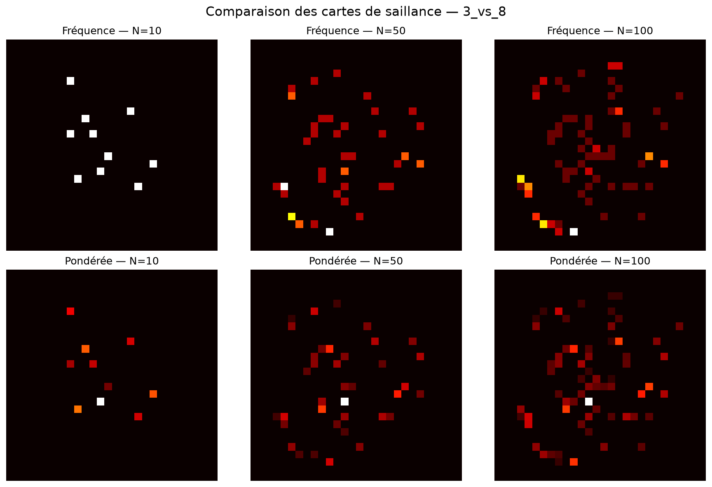
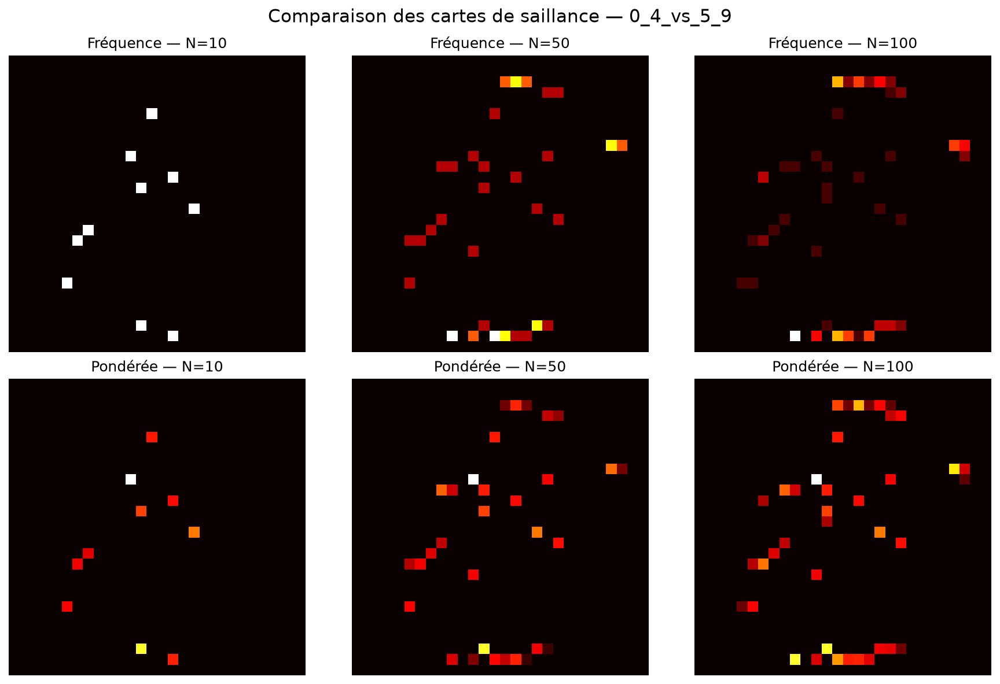

# DM2_Machine_Learning
DM2 - Boosting et cartes de saillance - IODAA AgroParisTech

# DM-2 — Boosting et cartes de saillance

**AgroParisTech — IODAA | Machine Learning**

**Auteurs :** Lucca Santos et Antoine

## Présentation du projet

Ce projet a été réalisé dans le cadre du devoir maison DM-2 consacré aux méthodes de boosting et à l'interprétabilité des modèles de classification.

L'objectif est d'étudier les performances de l'algorithme AdaBoost sur le jeu de données MNIST, puis d'analyser les pixels utilisés par les classifieurs de base à travers des cartes de saillance.

Le travail est organisé en deux exercices :

- **Exercice 1 — Boosting :** comparaison de différentes configurations d'AdaBoost.
- **Exercice 2 — Cartes de saillance :** visualisation des pixels sélectionnés par les *decision stumps*.

## 1. Jeu de données

Le jeu de données MNIST contient 70 000 images de chiffres manuscrits, représentées par 784 pixels (28 × 28).

Les pixels sont normalisés entre 0 et 1, sans réduction de dimension par ACP (*PCA*).

Deux problèmes de classification binaire sont étudiés :

- **3 contre 8 :** distinction entre les chiffres 3 et 8.
- **0–4 contre 5–9 :** distinction entre les chiffres de 0 à 4 et ceux de 5 à 9.

Les données sont divisées en ensembles d'entraînement (80 %) et de test (20 %), avec une stratification des classes et `random_state=42`.

## 2. Exercice 1 — Boosting

Nous utilisons l'algorithme AdaBoost avec quatre types de classifieurs de base :

- Arbre de décision de profondeur 1 (*decision stump*) ;
- Arbre de décision de profondeur 3 ;
- Arbre de décision de profondeur 8 ;
- Perceptron.

Pour chaque classifieur, trois nombres d'estimateurs sont testés : **10, 50 et 100**.

Les expériences couvrent donc 24 configurations au total.

Les performances sont évaluées à l'aide des indicateurs suivants :

- Accuracy ;
- Précision ;
- Rappel (*recall*) ;
- Score F1 ;
- Matrice de confusion ;
- Temps d'entraînement.

Les résultats sont enregistrés dans `results/resultats_adaboost.csv`.

Des graphiques permettent de comparer l'évolution des performances en fonction du nombre d'estimateurs et du classifieur utilisé.

### Résultats expérimentaux — AdaBoost

Les 24 configurations ont été exécutées avec succès.

Les meilleures performances sont obtenues avec des arbres de décision de profondeur 8 et 100 estimateurs.

| Classifieur | Accuracy 3 vs 8 | Accuracy 0–4 vs 5–9 |
|---|---:|---:|
| Decision stump | 95,53 % | 81,49 % |
| Arbre — profondeur 3 | 99,07 % | 93,36 % |
| **Arbre — profondeur 8** | **99,28 %** | **98,01 %** |
| Perceptron | 94,99 % | 83,33 % |

*Résultats correspondant à 100 estimateurs demandés. Pour le perceptron, l'entraînement s'est arrêté après 8 et 7 estimateurs respectivement.*

Les arbres de profondeur 8 présentent les meilleures performances, mais nécessitent également davantage de temps de calcul.

Les résultats montrent que l'augmentation du nombre d'estimateurs améliore généralement les performances des arbres de décision, avec des gains qui tendent à diminuer.

#### Évolution des performances

**Classification 3 contre 8**



**Classification 0–4 contre 5–9**



Les résultats détaillés, incluant les matrices de confusion et les temps d'entraînement, sont disponibles dans le notebook `02_adaboost.ipynb` et le fichier `results/resultats_adaboost.csv`.

## 3. Exercice 2 — Cartes de saillance

Nous étudions les pixels utilisés par les *decision stumps* entraînés avec AdaBoost.

Chaque stump sélectionne un pixel parmi les 784 caractéristiques disponibles.

Deux représentations sont construites :

**Carte de fréquence**

Elle représente le nombre de fois où chaque pixel est sélectionné par les stumps.

**Carte pondérée**

Elle représente la somme des poids AdaBoost associés aux stumps utilisant chaque pixel.

Ces cartes permettent d'étudier la répartition spatiale des caractéristiques utilisées par les modèles.

### Résultats quantitatifs

| Classification | Estimateurs | Pixels distincts | Pourcentage |
|---|---:|---:|---:|
| 3 vs 8 | 10 | 10 | 1,28 % |
| 3 vs 8 | 50 | 37 | 4,72 % |
| 3 vs 8 | 100 | 64 | 8,16 % |
| 0–4 vs 5–9 | 10 | 10 | 1,28 % |
| 0–4 vs 5–9 | 50 | 32 | 4,08 % |
| 0–4 vs 5–9 | 100 | 40 | 5,10 % |

Les résultats montrent que les modèles réutilisent certains pixels et que les cartes restent relativement clairsemées, même avec 100 estimateurs.

Les cartes pondérées apportent une information complémentaire en tenant compte de la contribution des différents stumps.

### Visualisation des cartes de saillance

Les cartes suivantes permettent de comparer les pixels sélectionnés par les decision stumps avec 10, 50 et 100 estimateurs.

**Classification 3 contre 8**



**Classification 0–4 contre 5–9**



Les cartes de fréquence montrent combien de fois chaque pixel a été sélectionné. Les cartes pondérées prennent également en compte les poids des estimateurs AdaBoost.

Les résultats montrent qu'avec 100 estimateurs, seulement 64 pixels distincts sont sélectionnés pour la classification 3 contre 8, contre 40 pixels pour la classification 0–4 contre 5–9.

Cela met en évidence la réutilisation de certaines caractéristiques et la concentration des décisions sur un nombre limité de pixels.

## 4. Organisation du projet

```text
DM2_Machine_Learning/
├── notebooks/
│   ├── 01_exploration_mnist.ipynb
│   ├── 02_adaboost.ipynb
│   └── 03_saliency_maps.ipynb
├── src/
├── data/
├── results/
│   ├── resultats_adaboost.csv
│   ├── accuracy_3_vs_8.png
│   ├── accuracy_0_4_vs_5_9.png
│   ├── confusion_matrices_3_vs_8.png
│   ├── confusion_matrices_0_4_vs_5_9.png
│   ├── models/
│   └── saliency_maps/
├── reports/
├── requirements.txt
├── .gitignore
└── README.md
```

Les dossiers `data/` et `results/models/` ne sont pas versionnés sur GitHub afin d'éviter le stockage de fichiers volumineux.

## 5. Installation et exécution

### Cloner le dépôt

```bash
git clone git@github.com:LuccaFaccin/DM2_Machine_Learning.git
cd DM2_Machine_Learning
```

### Créer un environnement virtuel

```bash
python3 -m venv .venv
source .venv/bin/activate
```

### Installer les dépendances

```bash
pip install -r requirements.txt
```

### Lancer JupyterLab

```bash
jupyter lab
```

### Ordre d'exécution

Les notebooks doivent être exécutés dans l'ordre suivant :

1. `01_exploration_mnist.ipynb` : téléchargement, exploration et préparation des données MNIST.
2. `02_adaboost.ipynb` : entraînement des modèles AdaBoost et évaluation des performances.
3. `03_saliency_maps.ipynb` : génération et analyse des cartes de saillance.

Le premier notebook génère les données nécessaires aux expériences suivantes. Le deuxième enregistre les modèles avec *decision stumps* utilisés dans le troisième.

## 6. Technologies utilisées

- Python
- NumPy
- Pandas
- Matplotlib
- Scikit-learn
- JupyterLab
- Joblib
- tqdm

## 7. Conclusion

Ce projet permet d'étudier l'influence du choix du classifieur de base et du nombre d'estimateurs sur les performances d'AdaBoost.

L'analyse des cartes de saillance montre également que les modèles peuvent exploiter un nombre limité de pixels et réutiliser certaines caractéristiques au cours du boosting.

L'utilisation conjointe des cartes de fréquence et des cartes pondérées permet de mieux comprendre les caractéristiques sélectionnées par les modèles.

---

*Projet académique — AgroParisTech, IODAA — 2026/2027*
